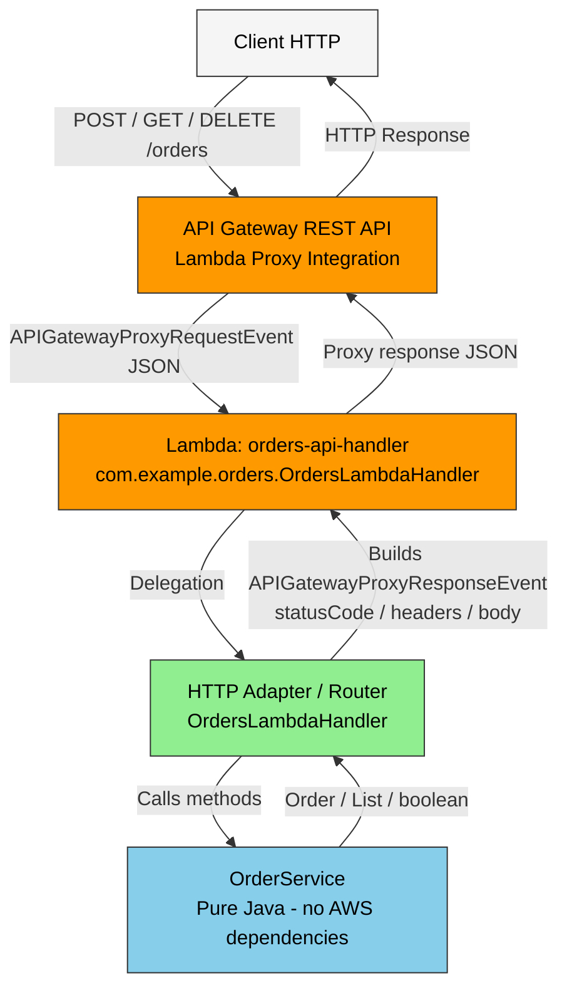

# Serverless REST API — Order Management API

## 1. Introduction

In this workshop, you will design, implement, and deploy a small serverless REST API using:

- Java 17
- Maven
- AWS Lambda
- Amazon API Gateway
- JUnit
- An AI coding assistant or LLM

## 2. Learning Objectives

At the end of this workshop, you should be able to:

- Implement and test simple Java functions independently from AWS.
- Package Java code and execute it using AWS Lambda.
- Understand how AWS Lambda maps JSON input to Java objects.
- Design a small REST API using resources and HTTP methods.
- Configure Amazon API Gateway to expose Lambda functions.
- Use path parameters and query parameters.
- Implement appropriate HTTP status codes and error responses.
- Compare API Gateway custom integration with Lambda proxy integration.
- Separate application logic from infrastructure-specific code.
- Use an LLM as an engineering assistant while critically evaluating its architectural decisions.

## 3. Problem

Your team must develop a small Order Management API. 

An order contains at least:

```json
{
  "id": "ORD-001",
  "customerId": "CUST-42",
  "product": "MacBook Air",
  "quantity": 1
}
```

The API must initially support three operations:

| Operation | HTTP Request |
|-----------|--------------|
| Create an order | `POST /orders` |
| Retrieve an order | `GET /orders/{id}` |
| Find orders belonging to a customer | `GET /orders?customerId={customerId}` |

For this workshop, a database is not required. You may use an in-memory collection. Keep in mind that AWS Lambda execution environments are ephemeral, so in-memory data must not be considered persistent storage.

## 4. Before You Start: API Design (Section 4)

The API manages orders as a resource: `/orders`.

### API Contract

| Operation | Method | URL | Path params | Query params | Request body | Success body | Success status | Errors | Error status |
|-----------|--------|-----|-------------|--------------|--------------|--------------|----------------|--------|--------------|
| Create an order | `POST` | `/orders` | — | — | `{"customerId": "...", "product": "...", "quantity": 1}` | Complete `Order` | `201 Created` + `Location: /orders/{id}` | Invalid input | `400 Bad Request` |
| Retrieve an order | `GET` | `/orders/{id}` | `id` | — | — | `Order` | `200 OK` | Not found | `404 Not Found` |
| Find orders by customer | `GET` | `/orders` | — | `customerId` | — | `[]` or `[Order,...]` | `200 OK` | Missing/invalid parameter | `400 Bad Request` |
| Delete an order | `DELETE` | `/orders/{id}` | `id` | — | — | empty | `204 No Content` | Not found | `404 Not Found` |

### Consistent Error Format

All errors follow this JSON structure:

```json
{
  "error": "ORDER_NOT_FOUND",
  "message": "Order ORD-999 does not exist"
}
```

### Design Questions

- **What are the resources in your API?** The orders collection (`/orders`) and an individual order resource (`/orders/{id}`).
- **Why did you choose `/orders/{id}` to retrieve a particular order?** The `id` uniquely identifies a single order resource, so it belongs in the path as a path parameter. This follows REST conventions where the URL identifies the resource.
- **Why is `customerId` represented as a query parameter in the search operation?** `customerId` filters a collection rather than identifying a single resource. Query parameters are the appropriate mechanism for collection filtering/search.
- **What should `POST /orders` return when an order is successfully created?** `201 Created` with the created `Order` object in the body and a `Location: /orders/{id}` header pointing to the newly created resource.
- **What should the API return when an order does not exist?** `404 Not Found` with the standard error JSON (`error` code + `message`).
- **What information should an error response contain?** A stable, machine-readable `error` code and a human-readable `message`.

## 5. Phase 1 — Part I: Implement the Application in Plain Java (Sections 5-6)

### Project Structure

```text
orders-api/
├── pom.xml
└── src/
    ├── main/java/com/example/orders/
    │   ├── Order.java
    │   ├── CreateOrderRequest.java
    │   ├── OrderNotFoundException.java
    │   ├── OrderService.java
    │   ├── ErrorResponse.java
    │   ├── CreateOrderHandler.java
    │   ├── OrdersLambdaHandler.java
    │   └── OrdersStreamHandler.java
    └── test/java/com/example/orders/
        ├── OrderServiceTest.java
        └── OrdersLambdaHandlerTest.java
```

### Implementation

- `Order`: Domain entity with `id`, `customerId`, `product`, `quantity`
- `CreateOrderRequest`: Input DTO for order creation
- `OrderNotFoundException`: Domain exception
- `OrderService`: Pure business logic backed by an in-memory `ConcurrentHashMap`. Implements `createOrder`, `getOrder`, `getOrdersByCustomer`, and `deleteOrder`. No HTTP, API Gateway, Spring Boot, or web server dependencies.
- `OrdersLambdaHandler`: HTTP adapter for Lambda Proxy Integration using `APIGatewayProxyRequestEvent` and `APIGatewayProxyResponseEvent`.

The business logic remains completely independent from infrastructure concerns.

### Local Testing

```bash
mvn test
```

**Result:** 16 tests passed (9 `OrderServiceTest` + 7 `OrdersLambdaHandlerTest`)

### Packaging

```bash
mvn package -DskipTests
```

This generates a fat JAR with all dependencies at `target/orders-api-1.0.0.jar` via the `maven-shade-plugin`.

### Checkpoint 1

| Question | Answer |
|----------|--------|
| Can the application functionality be tested without AWS? | Yes, with plain JUnit tests. |
| Does your application require a web server? | No. |
| Does it require Spring Boot? | No. |
| What does the generated JAR contain? | Compiled domain classes, infrastructure adapters, and all dependencies bundled into a fat JAR. |
| Which parts of your application currently know about HTTP? | Only the HTTP adapters/handlers (`OrdersLambdaHandler`, `OrdersStreamHandler`). The domain logic (`OrderService`, entities, exceptions) has no HTTP knowledge. |

## 6. Phase 2 — Part II: Deploy a Java Function to AWS Lambda (Section 7)

A single Lambda function (`orders-api-handler`) is used for the complete Orders API. The handler is configured as:

- **Handler:** `com.example.orders.OrdersLambdaHandler::handleRequest`
- **Runtime:** Java 17 (Amazon Corretto 17)
- **Packaging:** Fat JAR uploaded to Lambda
- **Integration:** API Gateway Lambda Proxy Integration

See [README_AWS.md](../README_AWS.md) for build and deployment commands.

### JSON ↔ Java Conversion

The AWS Lambda Java runtime automatically deserializes the incoming JSON event into Java objects and serializes Java return values back to JSON. For Lambda Proxy Integration, the adapter works with `APIGatewayProxyRequestEvent` and `APIGatewayProxyResponseEvent` from `aws-lambda-java-events`, with `Gson` used for explicit serialization where needed.

### Checkpoint 2

```text
JSON
  |
  v
AWS Lambda Runtime
  |
  v
Java Object
  |
  v
Java Function (OrdersLambdaHandler / OrderService)
  |
  v
Java Object
  |
  v
JSON
```

The deployed solution follows this flow, with the HTTP adapter translating between the API Gateway proxy event and the pure Java domain.

## 7. Phase 3 — Parts III & IV: API Gateway Mapping Templates (Architecture A) (Sections 8-10)

Before moving to proxy integration, API Gateway can be configured with mapping templates (non-proxy integration) to extract and transform data.

For example:
- `GET /orders/{id}` extracts `{id}` from the path and sends `{"id": "ORD-001"}` to Lambda
- `GET /orders?customerId=...` extracts the query parameter and transforms it to the expected JSON
- `POST /orders` can pass the body through to Lambda

See [docs/mapping-templates.md](docs/mapping-templates.md) for concrete VTL mapping template examples.

### Checkpoint 3 — API Gateway Responsibilities (Architecture A)

When using API Gateway mapping templates/non-proxy integration, API Gateway is responsible for:

- **Routing:** Matching resources and HTTP methods
- **Extracting path parameters:** Obtaining values like `{id}` from the URL
- **Extracting query parameters:** Obtaining `customerId` from query strings
- **Transforming requests:** Building the exact JSON payload Lambda expects (VTL mapping templates)
- **Transforming responses:** Mapping Lambda output to HTTP responses
- **Choosing status codes:** Defining Method/Integration responses for different outcomes
- **Mapping errors:** Translating Lambda errors to appropriate HTTP status codes and error JSON

**Advantages:** Lambda stays minimal, HTTP semantics centralized in API Gateway.  
**Disadvantages:** Configuration grows quickly, VTL is harder to test/debug locally, responsibilities are split across two places, and maintenance becomes more complex as the API scales.

## 8. Phase 4 — Part V: Lambda Proxy Integration + HTTP Adapter (Sections 11-13)

The final approach uses **Lambda Proxy Integration**. API Gateway passes the full HTTP event to Lambda, and a thin HTTP adapter handles all HTTP concerns.

### Proxy Event Investigation

The API Gateway proxy event contains key fields such as `httpMethod`, `path`, `resource`, `pathParameters`, `queryStringParameters`, `headers`, `body`, and `isBase64Encoded`. 

See [docs/proxy-event-example.json](docs/proxy-event-example.json) for a representative example.

### Final Architecture

```text
Client (HTTP)
    ↓
API Gateway REST API (Lambda Proxy Integration)
    ↓ (APIGatewayProxyRequestEvent JSON)
Lambda (orders-api-handler)
    ↓
HTTP Adapter / Router (OrdersLambdaHandler)
    ↓
Application Logic (OrderService - pure Java)
```

**Separation of concerns:** `OrderService` has no AWS imports. `OrdersLambdaHandler` is responsible for parsing the event, routing, extracting parameters, calling the domain service, and building the `APIGatewayProxyResponseEvent` with appropriate status codes and headers.

### Implemented HTTP Responses

| Case | Status Code | Response Body |
|------|-------------|---------------|
| Retrieve existing order | `200 OK` | `{"id": "...", "customerId": "...", "product": "...", "quantity": ...}` |
| Create order | `201 Created` | Created order JSON + `Location: /orders/{id}` header |
| Retrieve by customerId | `200 OK` | Array of orders `[]` or `[Order,...]` |
| Delete existing order | `204 No Content` | Empty body |
| Order not found | `404 Not Found` | `{"error": "ORDER_NOT_FOUND", "message": "..."}` |
| Invalid input | `400 Bad Request` | `{"error": "INVALID_REQUEST", "message": "..."}` |
| Unexpected internal error | `500 Internal Server Error` | `{"error": "INTERNAL_ERROR", "message": "Unexpected internal error"}` |

See [docs/examples/requests-responses.md](docs/examples/requests-responses.md) for full curl examples and responses.

## 9. Phase 5 — Architecture Comparison (Section 14)

| Aspect | A) API Gateway Mapping (Non-Proxy) | B) Lambda Proxy + HTTP Adapter |
|--------|--------------------------------------|---------------------------------|
| API Gateway configuration | Higher (resources, methods, Integration Request/Response, VTL templates, status mappings) | Lower (just enable Lambda Proxy Integration) |
| Java infrastructure code | Lower (simpler handler) | Higher (adapter/router with HTTP concerns) |
| Local testing | Harder (heavily dependent on API Gateway transformations) | Easier (can unit test the handler and service with Java objects, no AWS required) |
| Where status codes are defined | API Gateway (Method/Integration Response mappings) | Java HTTP Adapter (`OrdersLambdaHandler`) |
| Scaling to 30 operations | Poor (template/config explosion) | Better (central router/handler, easier to extend) |
| Clean business logic | Acceptable if very simple | Excellent (domain fully isolated from HTTP/AWS) |
| Ease of understanding for another developer | Requires knowledge of VTL and API Gateway mappings | More idiomatic Java, follows a standard and testable pattern |
| Recommendation for larger systems | Only for very small, fixed-scope APIs | **Recommended** for maintainability, testability, and long-term evolution |

## 10. Phase 6 — AI-Assisted Development & Critique (Sections 15-16)

### Prompt Used (Collaborative, not "build for me")

```text
I have a Java 17 Lambda Orders API with pure business logic (OrderService).
I want to expose it through Amazon API Gateway using Lambda proxy integration.
Keep OrderService independent of AWS-specific classes.
Before generating code: propose the architecture, identify files to change/create, explain where HTTP responsibilities will reside.
Do not implement anything until the architecture has been explained.
```

### Critical Analysis of AI Decisions

#### 1) Single Lambda vs one Lambda per operation
- **Decision proposed:** Evaluate both approaches rather than defaulting blindly
- **Reason:** One Lambda per operation can look cleaner but adds deployment and routing complexity
- **Do I agree?** Partially
- **Alternative:** Single Lambda with a router/adapter
- **What was implemented and why:** A single `OrdersLambdaHandler` as the HTTP adapter. This is simpler for this API, reuses the shared `OrderService`, and is easier to reason about. If the API grows significantly, splitting could be reconsidered.

#### 2) Validation in Service vs Adapter
- **Decision proposed:** Consider where validation belongs
- **Reason:** Mixing HTTP-specific validation with core business rules blurs responsibilities
- **Do I agree?** Yes
- **Alternative:** Put all domain rules in `OrderService`, keep only minimal request shape checks in the adapter
- **What was implemented and why:** `OrderService` enforces domain validation (required fields, quantity > 0). The adapter maps `IllegalArgumentException` to `400 Bad Request` and `OrderNotFoundException` to `404 Not Found`. This preserves a clean separation between business rules and HTTP concerns.

#### 3) Using AWS classes vs POJOs / RequestStreamHandler & packaging
- **Decision proposed:** Use `aws-lambda-java-events` with a POJO handler (`RequestHandler<APIGatewayProxyRequestEvent, APIGatewayProxyResponseEvent>`)
- **Reason:** Less boilerplate and aligns with Lambda Proxy Integration
- **Do I agree?** Yes
- **Alternative:** Use `RequestStreamHandler` with manual JSON parsing
- **What was implemented and why:** `OrdersLambdaHandler` uses the POJO approach with `Gson` for explicit serialization. A critical lesson: the agent did not initially warn about needing a **fat JAR with dependencies**. This was corrected by adding `maven-shade-plugin` to `pom.xml`. The decision was evaluated based on engineering tradeoffs, not just compilation.

**Takeaway:** The AI was a useful engineering collaborator, but architecture decisions were reasoned and validated manually. Never blindly accept generated architecture.

## 11. Phase 7 — Final Challenge: DELETE Extension (Section 17)

### Prediction (committed before implementation)
- **Classes to change:** `OrderService` (already had `deleteOrder`), `OrdersLambdaHandler` (add DELETE route), `ErrorResponse` (already exists)
- **New Lambda needed?** No. Use the single Lambda.
- **API Gateway configuration change?** Add `DELETE` method on `/orders/{id}` with Lambda Proxy Integration
- **Where should deletion logic reside?** In `OrderService.deleteOrder(String id)` (pure Java business logic)
- **Where should the decision to return 204 or 404 reside?** In `OrdersLambdaHandler` (HTTP responsibility)
- **Tests to add:** Delete existing order → `204 No Content`; delete non-existent order → `404 Not Found`

### Implementation
`DELETE /orders/{id}` is implemented in `OrdersLambdaHandler`:
- If the order exists → remove it and return `204 No Content` with empty body
- If the order does not exist → return `404 Not Found` with `{"error":"ORDER_NOT_FOUND","message":"Order <id> does not exist"}`

### Prediction vs Implementation
The prediction matched the final implementation. `OrderService` already contained `deleteOrder`, so minimal changes were needed. The 204/404 decision was correctly placed in the HTTP adapter. Tests for both cases were added to `OrdersLambdaHandlerTest`.

## 12. Final API (Section 18)

The final API supports:

- `POST /orders` - Create an order
- `GET /orders/{id}` - Retrieve an order by ID
- `GET /orders?customerId={customerId}` - Find orders by customer
- `DELETE /orders/{id}` - Delete an order

**Status codes used:** `200 OK`, `201 Created`, `204 No Content`, `400 Bad Request`, `404 Not Found`. For unexpected internal errors, the API returns `500 Internal Server Error` with `{"error":"INTERNAL_ERROR","message":"Unexpected internal error"}`.

## 13. Required Architecture Diagram (Section 19)



**Legend:**
- **Orange:** AWS components (API Gateway, Lambda)
- **Green:** HTTP adapter/infrastructure (Java)
- **Blue:** Pure business logic (Java, no AWS dependencies)

## 14. Deliverables (Section 20)

The repository contains:

```text
orders-api/
├── pom.xml
├── README.md
├── src/
│   ├── main/java/com/example/orders/
│   └── test/java/com/example/orders/
└── docs/
    ├── api-gateway-setup.md
    ├── mapping-templates.md
    ├── proxy-event-example.json
    └── examples/requests-responses.md
```

**Included:**
- Complete Java source code (domain, service, exceptions, handlers/adapters)
- Maven configuration (`pom.xml` with `maven-shade-plugin` for fat JAR)
- Unit tests (`OrderServiceTest`, `OrdersLambdaHandlerTest`)
- Lambda handler(s) (`OrdersLambdaHandler`, `CreateOrderHandler`, `OrdersStreamHandler`)
- API Gateway configuration and reproduction steps ([docs/api-gateway-setup.md](docs/api-gateway-setup.md))
- Example requests/responses ([docs/examples/requests-responses.md](docs/examples/requests-responses.md))
- Proxy event example ([docs/proxy-event-example.json](docs/proxy-event-example.json))
- Architecture A mapping templates ([docs/mapping-templates.md](docs/mapping-templates.md))
- Architecture diagram (above)
- Answers to design questions and checkpoints
- AI-assisted development analysis and critique
- Build/test instructions ([README_AWS.md](../README_AWS.md))

## 15. Demonstration (Section 21)

The demonstration should cover the following:

- [ ] Run tests locally: `mvn test`
- [ ] Package the application: `mvn package -DskipTests` (show fat JAR generation)
- [ ] Invoke Lambda directly (test event in AWS Console or CLI)
- [ ] Call the deployed API via HTTP
- [ ] Successful `POST /orders` (show `201 Created` + `Location`)
- [ ] Successful `GET /orders/{id}` (show `200 OK`)
- [ ] `404 Not Found` response
- [ ] `400 Bad Request` response
- [ ] `DELETE /orders/{id}` extension (`204 No Content` and/or `404 Not Found`)
- [ ] Walk through the architecture diagram

**Deployed test endpoint:** `https://ztegg7jbm4.execute-api.us-east-1.amazonaws.com/dev`

## 16. Evaluation (Section 22)

| Criterion | Description |
|-----------|-------------|
| API design | Correct use of resources, URLs, HTTP methods and status codes |
| Functionality | The API behaves according to its contract |
| Java design | Application logic is appropriately separated from infrastructure |
| Testing | Important behavior can be tested locally |
| AWS integration | Correct use of Lambda and API Gateway |
| Architecture | Responsibilities are placed deliberately and can be justified |
| AI-assisted development | AI is used productively and its output is critically evaluated |
| Understanding | You can explain the implementation and defend your architectural choices |

## 17. The Main Question (Section 23)

**Where should each responsibility live?**

When implementing anything, ask yourself:

1. **Is this an API Gateway responsibility?** (Routing, path/query extraction, request/response transformation, HTTP status mapping)
2. **Is this a Lambda/HTTP adapter responsibility?** (Parsing the event, orchestrating calls, translating exceptions to HTTP responses, building HTTP headers)
3. **Is this application logic responsibility?** (Business rules, validation, domain behavior - should remain pure Java with no HTTP/AWS knowledge)

A solution that works is only the beginning. The goal is to produce an architecture whose responsibilities are deliberate, testable, and defensible.

## Build, Test, and Package

```bash
# Run unit tests
mvn test

# Package into fat JAR
mvn package -DskipTests
```

**Lambda Handler:** `com.example.orders.OrdersLambdaHandler::handleRequest`  
**Runtime:** Java 17  
**Recommended Memory:** 512 MB  
**Recommended Timeout:** 30s
